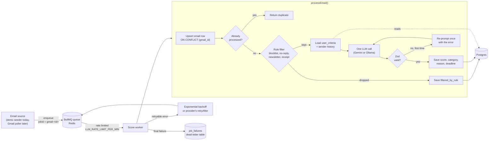

# Sift

An AI inbox triage service. Sift takes incoming email, drops obvious junk with cheap deterministic rules, asks an LLM to score what's left from 1 to 10 against your own criteria, and stores the result in Postgres. Scoring runs through a Redis-backed job queue with retries, backoff, rate limiting, and a dead-letter table.

It's built for a specific inbox: a CS student looking for co-ops who also does freelance work. Your criteria live in a database row, though, so the same pipeline works for any definition of "important".

```
$ npm run demo

Score  Category           Filtered by  LLM calls  LLM ms  From                            Subject
-----  -----------------  -----------  ---------  ------  ------------------------------  --------------------------------------------
9      interview_request  –            1          331     priya@examplecorp.test          Interview: Software Engineer Co-op (Spring …
8      academic           –            2          589     s.placeholder@northeastern.edu  Re: reference letter
8      freelance_client   –            2          277     dana@smallbakery.test           Website refresh: can you quote by Friday?
4      recruiting         –            1          177     hello@staffing-agency.test      Exciting opportunity!
2      marketing          –            1          222     deals@shopmart.test             Last chance: deadline tonight for 50% off
1      marketing          –            1          315     promo@spam.test                 URGENT: action required
–      –                  receipt      0          –       orders@shopmart.test            Your order #48213 has shipped
–      –                  newsletter   0          –       digest@devnews.test             This week in JavaScript
–      –                  blocklist    0          –       writer@substack.com             New post: thoughts on productivity

9 emails: 6 scored, 3 dropped by rules before the LLM, 0 dead-lettered.
Replayed demo_01: outcome "duplicate", 0 extra LLM calls (idempotent on gmail_id).
```

## How it works



1. A job goes onto the `score-email` BullMQ queue. Its job id comes from the Gmail message id, so enqueuing the same message twice while the first job exists does nothing.
2. The worker upserts the email row, then runs the **rule filter**, a pure function that drops blocklisted senders, `no-reply@` addresses, mailing-list mail (`List-Unsubscribe`, `List-Id`, `Precedence: bulk`), and receipts. Priority senders and priority keywords (like "interview" or "co-op") override the heuristics, so an interview invite from an applicant-tracking system's `no-reply@` address still reaches the model.
3. For mail that passes, the worker loads the user's criteria and the sender's last 5 scored emails (with any 👍/👎 feedback) from Postgres and puts both in the prompt.
4. One LLM call returns structured JSON: `reason`, `category`, `score`, `isTimeSensitive`, `deadline`. Zod validates it. If it's invalid, the model is asked once more.
5. The result is written with a conditional update, so each email is processed at most once.

## Tech stack

| | |
|---|---|
| Language | TypeScript (strict, `noUncheckedIndexedAccess`), Node.js 20+ |
| Queue | BullMQ on Redis 7 |
| Database | PostgreSQL 16, Drizzle ORM + drizzle-kit migrations |
| LLM | Google Gemini (hosted) or Ollama (local), chosen with `LLM_PROVIDER` |
| Validation | Zod, for both environment config and model output |
| Logging | pino (JSON in production, pretty in dev), with secret redaction |
| Tests | Vitest: mocked unit tests, plus integration tests against real Postgres + Redis |
| Local infra | Docker Compose |

## Setup

You need Node.js 20+ and Docker.

```bash
git clone https://github.com/jiaamarnani/sift.git
cd sift
npm install

cp .env.example .env            # DATABASE_URL and REDIS_URL defaults already match docker-compose
docker compose up -d --wait     # Postgres on :5433, Redis on :6380

npm run db:migrate
npm run db:seed                 # inserts the default user_criteria row
```

### Run the demo

```bash
npm run demo
```

This seeds 9 synthetic emails into a separate `sifter_demo` database, runs them through the real queue and worker, and prints the table above. It needs no API key: the LLM is replaced by canned replies, and everything else is real (rule filter, prompt building, Zod validation, re-prompt, BullMQ retries, Postgres writes). Two of the canned replies fail on purpose, one with invalid JSON and one with an HTTP 503, so you can see the re-prompt and the retry.

To score the same synthetic emails with a real model:

```bash
# Gemini: set GEMINI_API_KEY in .env (free key at https://aistudio.google.com/apikey)
npm run demo -- --live

# Or locally with Ollama: `ollama pull llama3.1:8b`, then set LLM_PROVIDER=ollama in .env
npm run demo -- --live
```

### Run the worker

```bash
npm run dev:worker
```

This starts the long-running worker against your `.env` provider. Nothing feeds it yet except the demo; Gmail ingestion is listed under [Future work](#future-work).

## Design decisions

**Retries and backoff.** Every error says whether it's worth retrying. `ProviderError` maps HTTP 408, 429, and 5xx to retryable, and every other 4xx (bad API key, unknown model) to permanent. Retryable errors get up to 5 attempts with exponential backoff (5s, 10s, 20s, 40s, ±20% jitter so a batch of emails that all hit the same 503 doesn't retry in lockstep). When the provider says how long to wait, as Gemini's 429 responses do, the worker waits exactly that long instead of guessing. Errors with no verdict, like a dropped Postgres connection, are treated as transient: retrying a real bug wastes four attempts, but dead-lettering a network blip loses an email.

**Idempotency.** The `emails.gmail_id` unique constraint is the guarantee, enforced in the database so it holds even when two workers race. The worker inserts with `ON CONFLICT DO NOTHING` and reads the row back. If it's already processed, the job is a replay and stops before any LLM call. The final write is conditional on `processed_at IS NULL`, so if two jobs do race past the first check, only one write lands. BullMQ's job-id dedupe is a cheap first layer, not the guarantee, because completed jobs are eventually removed from Redis.

**Dead-letter.** On the final failed attempt, or immediately for a permanent error, the worker writes a `job_failures` row with the error and attempt count before BullMQ marks the job failed. That write happens inside the job processor, not in an event handler, so it's awaited and can't be lost. Postgres is the record because Redis trims failed jobs. When the cause was bad model output, the raw reply is stored too.

**Rate limiting.** BullMQ's limiter caps jobs started per minute across all workers on the queue, set by `LLM_RATE_LIMIT_PER_MIN`. The default of 5 matches Gemini's free tier. It's enforced in Redis, so it holds across multiple worker processes.

**One LLM call per email, no tool calling.** The first design had the model call `get_user_criteria()` and `get_sender_history()` as tools. Instead the worker fetches both before the call and puts them in the prompt. Tool calling would cost 2 to 3 requests per email against a free tier of 20 requests a day, and small local models are unreliable at tool calls.

**Provider-agnostic scoring.** An `LlmProvider` does one thing: send a system prompt, user prompt, and JSON schema, and return raw text. Parsing, validation, and interpretation live in the scorer, so one backend's quirks can't leak into the pipeline as a different-shaped result. Adding a backend means implementing `complete()`. Gemini and Ollama both enforce the response schema with structured output.

**Zod validation and re-prompt.** Structured output is a request, not a guarantee, so a score of 11 or a missing `reason` fails at the Zod schema instead of reaching the database. On the first invalid reply, the scorer asks again with the validation error appended (but not the bad reply, which tends to anchor the model on the same mistake). A second invalid reply is a `ScoreParseError`, which is permanent: a model that fails the same prompt twice at temperature 0 will keep failing it. Small problems are fixed in place instead: an unknown category falls back to `other`, and an unparseable deadline is dropped.

**Rule filter favors recall.** A newsletter that slips through costs one API call and gets scored 2/10. An interview invite dropped by the filter is never seen by anything downstream. So the heuristics are narrow and header-based, and keyword exemptions override them.

**Prompt injection.** Email content is untrusted input. The prompt fences it in `<email>` tags, neutralizes attempts to close those tags, and tells the model that instructions inside the email are content to score, not commands. The demo and the live tests include an email that tries to score itself 10.

**Validated config.** `src/config/env.ts` parses `process.env` with Zod at boot, so a missing or malformed variable crashes on startup with a readable message instead of failing hours later.

## Tests

```bash
npm test             # unit tests, fully mocked, no infrastructure needed
npm run test:int     # integration tests: real Postgres + Redis, mocked LLM
npm run test:live    # opt-in: real LLM calls with synthetic emails
npm run typecheck
```

- **Unit tests** (162) cover the rule filter, address parsing, prompt building, output parsing and re-prompt, both providers' HTTP handling and error mapping, and the retry policy.
- **Integration tests** (16) run the whole worker path against real Postgres and Redis from docker compose, with only the LLM faked. They check that BullMQ really retries with the custom backoff, that `ON CONFLICT` really dedupes concurrent jobs, that the dead-letter row really lands, and that the limiter really holds jobs back. They use a separate `sifter_test` database and Redis DB 1, so they never touch dev data.
- **Live tests** call the configured provider with six synthetic emails and check that scores land in wide expected bands. They're opt-in because Gemini's free tier allows 20 requests a day.

## Project layout

```
src/
  config/env.ts         Zod-validated environment
  db/                   Drizzle schema, client, migrations runner, criteria seed
  rules/filter.ts       deterministic pre-LLM filter
  scoring/              prompt, scorer (Zod + re-prompt), Gemini and Ollama providers
  pipeline/             processEmail(): filter → score → persist, sender history query
  queue/                BullMQ queue, worker, retry/backoff policy
  worker/main.ts        worker process entry point
  demo/                 npm run demo
tests/
  integration/          real Postgres + Redis
  live/                 opt-in real LLM calls
drizzle/                SQL migrations
```

## Future work

The schema already has tables for most of this (`feedback`, `notifications`, `user_criteria.threshold` and `digest_time`).

- **Gmail ingestion.** OAuth consent flow and a poller every 15 minutes that enqueues new messages, with `gmail_id` as the idempotency key.
- **Telegram alerts.** A `Notifier` interface with a Telegram implementation that messages you when an email scores above your threshold, with 👍/👎 buttons. Feedback comes back through a webhook that verifies Telegram's secret-token header, and it feeds into the sender history the scorer already reads.
- **Daily digest.** One email a day of everything at or above the threshold in the last 24 hours, grouped by category and sorted by score.
- **Metrics.** A `GET /metrics` endpoint: emails processed, percent filtered (by rule), LLM latency, failure rate, notifications per channel, and precision from 👍/👎 feedback.
- **Evals.** A harness of about 30 labeled synthetic emails that reports precision and recall per provider and model, run in GitHub Actions CI alongside the unit and integration tests.
- **Deployment.** Config for Railway or Fly.io.
